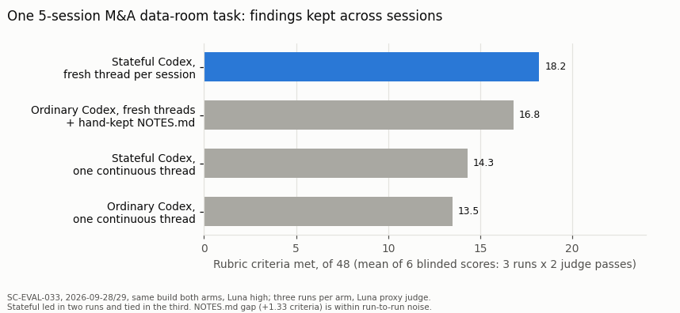
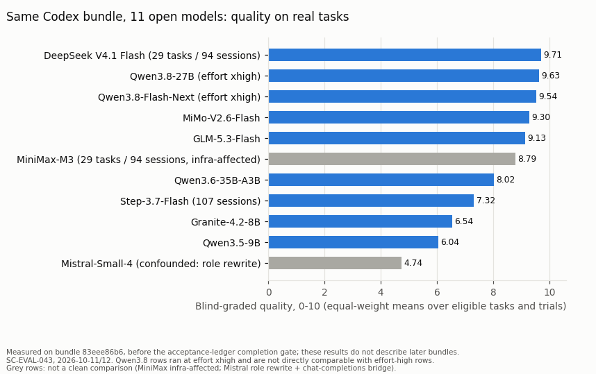
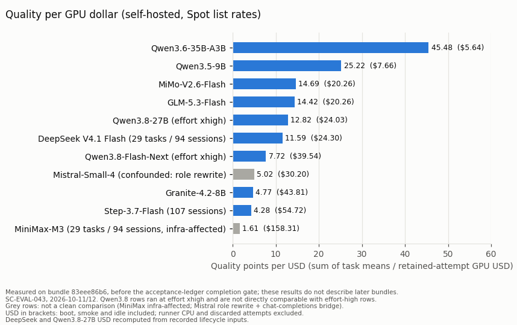
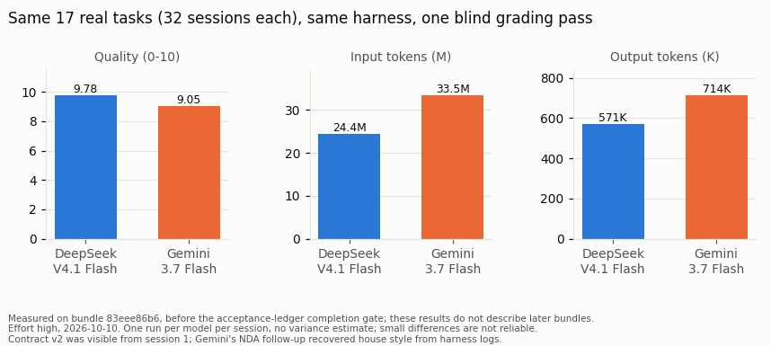
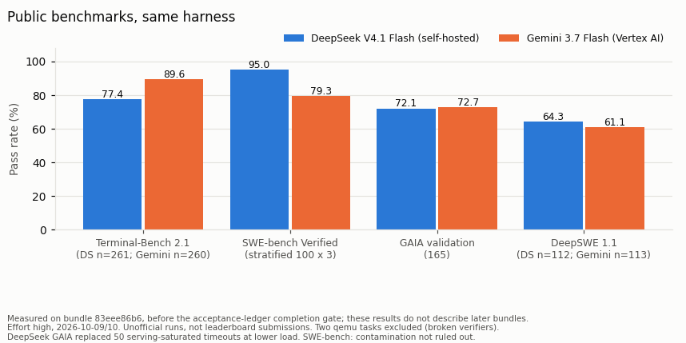
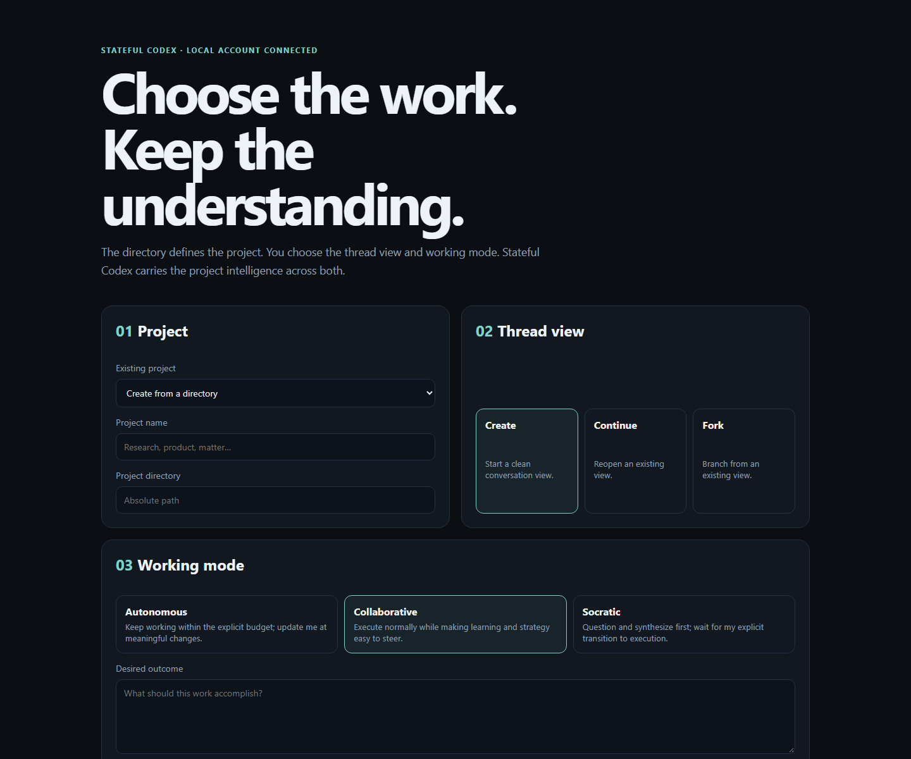

<div align="center">

# Stateful Codex

### Choose the work. Keep the understanding.

**Memory and continuity across sessions for Codex: one harness that remembers what your project has learned.**

[Product intent](./STATEFUL_CODEX_PRODUCT_INTENT.md) · [Evaluation record](./STATEFUL_CODEX_EVALUATION.md) · [Master plan](./STATEFUL_CODEX_MASTER_PLAN.md) · [Current state](./STATEFUL_CODEX_CURRENT_STATE.md) · [Web client](./clients/stateful-codex)


</div>

## Start here

This is the Stateful fork, not the released upstream Codex package. The canonical
repository is [stateful-codex](https://github.com/dl1683/stateful-codex), and
**`main` is the only maintained development branch**. Historical
`archive/20261020/...` tags are recovery references, not development branches.
Temporary contributor PR heads target `main`; they are not parallel product lines.
Upstream OpenAI changes enter through pinned, reviewed batches into `main`, not
by replacing it with upstream. See [contributing](./CONTRIBUTING.md).

### Reading map

| You want to… | Read |
| --- | --- |
| Build the CLI and companion | [Development](./DEVELOPMENT.md) |
| Try the CLI in disposable storage | [Quickstart](#try-it), then [configuration](./CONFIGURATION.md) |
| Start the browser and exercise memory/Forget | [Client walkthrough](./clients/stateful-codex/README.md) |
| Understand the code and vocabulary | [Architecture](./ARCHITECTURE.md), [glossary](./STATEFUL_CODEX_GLOSSARY.md) |
| Make and test a first PR | [Contributing](./CONTRIBUTING.md), [testing](./TESTING.md), [AGENTS.md](./AGENTS.md) |
| Separate implemented behavior from promises | [Current state](./STATEFUL_CODEX_CURRENT_STATE.md), [110-item roadmap](./STATEFUL_CODEX_ROADMAP.md) |
| Understand holds and rejected designs | [Decisions](./STATEFUL_CODEX_DECISIONS.md) |
| Recover historical work | [Consolidation ledger](./STATEFUL_CODEX_CONSOLIDATION.md) |
| Read product intent and historical measurements | [Product intent](./STATEFUL_CODEX_PRODUCT_INTENT.md), [evaluation ledger](./STATEFUL_CODEX_EVALUATION.md), [evaluation history](./STATEFUL_CODEX_EVALUATION_HISTORY_2026_09_TO_10_08.md) |
| Read earlier plans, as history rather than current instructions | [Master plan](./STATEFUL_CODEX_MASTER_PLAN.md), [memory design](./STATEFUL_CODEX_MEMORY_DESIGN_2026_10_06.md), [plan history](./STATEFUL_CODEX_PLAN_HISTORY.md) |

### Capability labels

**Landed** means present in source, not universally reliable or release-qualified.
At the documentation baseline `997007527c5bb1d03c4d6b67cd5f8786b37b3e17`:

| Status | Capability and limit |
| --- | --- |
| Landed | Project hierarchy, blackboards, context maps, bounded memory/context reads and direct add/correct/Forget controls. |
| Landed | Project-local native storage through `scripts/scodex.py`; direct native/web startup needs explicit home routing. This is not one physical database. |
| Landed | Loopback gateway Host/Origin/cookie protection, typed replies, memory paging and revision-keyed drafts. Windows web tests pass 128/128; fixtures do not prove native behavior. |
| Landed | Ask without a run; autonomous, collaborative and socratic Work modes. Work completion reliability remains limited. |
| Inactive | Canonical `memory.sqlite` domain components and offline capsule experiments. Source presence does not activate native cutover. |
| Held | Exact historical recall after repeated compaction, packet restoration, foreign-agent writes, populated migration 59/60 upgrades, broader Work/installation activation and HAL/offline acceptance. |
| Rejected | Regex confirmation as user authorization, automatic authority promotion, unsafe foreign Host writes, and merging the failing compaction stack behind a disabled flag. |

**Verification, 2026-10-20:** Windows/Node 22.19.0 web tests and ten launcher
tests pass. Native CLI/companion build, login/model turns and native memory
walkthrough are **UNVERIFIED**: no paired artifacts were present and the cold
build lacked RAM reserve above the required 20 GiB free floor. WSL, macOS and
Linux instructions are **UNVERIFIED** in this documentation pass. The runnable
[fixture quickstart](#verified-web-only-check) needs no account or Rust build.
Do not interpret historical results below as measurements of today's checkout.

## What it is

Coding agents forget. Every new thread starts cold, compaction drops details, and you end up re-explaining
decisions, rules and dead ends. Stateful Codex is a fork of OpenAI Codex that treats the directory you choose as a
durable project, and keeps what the agent learns about it:

- **Project memory.** Facts, decisions, rules, contradictions, open questions and rejected approaches, stored as
  structured blackboards that mirror your file tree and link back to source.
- **Reviewable project rules.** Supported declarations and direct controls retain rules with receipts.
  Eligibility and context bounds determine what applies; `/memory` exposes correction and Forget.
- **Continuity across threads.** A fresh thread starts from what the project already knows instead of rereading
  everything.
- **One harness across models.** The same Codex bundle runs OpenAI, Google and open-weight models through provider
  bridges.

The goal is not chat with memory. It is an execution environment that gets better informed as the project develops,
with a memory layer that other agents can use too: a Codex → Droid → Codex journey is on the roadmap.

> [!IMPORTANT]
> Stateful Codex is a research preview. Historical results link to the
> [evaluation record](./STATEFUL_CODEX_EVALUATION.md), which keeps losses and regressions beside wins. Updated
> October 9–10 DSG results are sourced from experiment logs whose redacted evidence has not yet been published.

## Historical testing and results

The following sections retain the September–October experiments and their
original limitations. “Newest” and “next” inside those experiment descriptions
are historical, not a release claim about the current baseline. Current
verification is stated above and in [current state](./STATEFUL_CODEX_CURRENT_STATE.md).

### How we tested it

- **Real work, not toy prompts.** Multi-session tasks on real repositories and document sets: data rooms, contracts,
  bug fixes, test suites, memos, tutoring and research briefs.
- **Blind grading.** Rubrics are frozen before any output exists. Grading used shuffled labels and scrubbed model identifiers. Ladder blinding was imperfect: MiniMax packets retained `<mm:think>` markers. Some graders viewed other score files after submitting their scores; no subsequent edits were reported.
- **Across models.** `gpt-5.6-luna`, GPT-6.1 Sol, Gemini 3.7 Flash, DeepSeek V4.1 Flash and 11 self-hosted open models.
- **Public benchmarks** for descriptive comparison: Terminal-Bench 2.1, SWE-bench Verified, GAIA, DeepSWE, LoCoMo and
  more.

## Results

### 1. Memory wins across sessions

**Fresh threads on a multi-document task.** In a five-session M&A data-room task (14 documents, a 48-criterion blind
rubric, the same build and model, Luna at high effort, in every arm): on this data-room task, Stateful fresh threads
scored 18.2/48 versus ordinary continuous threads' 13.5/48 across three runs per arm. Stateful led in two runs and tied
in the third. Each memo received two blinded Luna proxy-judge scores. The ordinary thread lost early,
cross-document findings to compaction.

<p align="center"></p>

Caveats: a disciplined hand-kept `NOTES.md` came close (16.8; the +1.33-criteria gap is within run-to-run noise).
Stateful used about 17% fewer uncached-input-plus-output tokens than the NOTES.md arm and required no per-session
process prompting. It used more tokens than the ordinary continuous thread (402-465k against 236-275k uncached plus
output), and one continuous Stateful thread was not reliably better than ordinary Codex. On a separate code-study task
the ranking flipped between runs.
([SC-EVAL-033](./STATEFUL_CODEX_EVALUATION_HISTORY_2026_09_TO_10_08.md#sc-eval-033-matched-behaviour-study-at-the-phase-a-freeze-campaign-ii-2026-09-2829))

**Rules and conversation-only context survive.** Over 20 fresh-thread sessions on one project, one run per arm per
build:

- A standing rule held in **20/20** sessions on two later builds, against **1/20** for ordinary Codex.
- Ordinary Codex needed two re-asks in every series, because it could not recall a brainstorm and a review that
  existed only in conversation.
- Cumulative input was **0.73x** and **0.82x** of ordinary Codex on those builds (0.83x and 0.89x if the re-asks
  are excluded).

Across many hands-on tests (each n=1 per arm) the pattern repeated: ordinary Codex lost conversation-only referents
and needed re-asks, while Stateful applied stated preferences in fresh threads.
([SC-EVAL-035](./STATEFUL_CODEX_EVALUATION_HISTORY_2026_09_TO_10_08.md#sc-eval-035-october-23-hands-on-campaign-campaign-ii-continued-2026-10-0203))

**Cheaper when work keeps returning to the same repositories.** On a 25-question eval with GPT-6.1 Sol, Stateful
cost **13.4% less** ($1.422 against $1.641 list-price equivalent). Both scored 10/10 on the objectively scored first
two batches. Later batches shared an accumulating store and were not independent. One run per arm; an earlier
incomplete-binary run was excluded. It cost more on the small one-shot batches (+89%, +55%).
([SC-EVAL-034](./STATEFUL_CODEX_EVALUATION_HISTORY_2026_09_TO_10_08.md#sc-eval-034-25-question-model-eval-gpt-61-sol-stateful-vs-ordinary-2026-09-30))

**Where it does not help yet.** On one frozen, restricted-read 12-turn baseline, ordinary Codex used 1.94M units and
10 compactions versus Stateful's 2.27M and 13, and produced the more complete deliverable
([SC-EVAL-040](./STATEFUL_CODEX_EVALUATION.md#sc-eval-040-frozen-long-thread-baseline-restricted-read-2026-10-10)).
Trivial lookups pay a fixed overhead. In a September 30 test, after a collaborator changed a project's status,
Stateful answered from stale memory (0/10 correct first answers against 7.5/10 for ordinary Codex).

### 2. One Codex bundle, 11 open models

We ran the same Stateful Codex bundle on 11 self-hosted open models with blind 0-10 grading (blinding imperfect; see How we tested). Scheduled: 32 tasks × 2
trials, 108 sessions per model. Graded support: DeepSeek 29 tasks/94 sessions after vision-off serving exclusions;
MiniMax 29 tasks/94 sessions after bridge outages and merged reruns; Step 32 tasks/107 sessions after one Spot
preemption; other arms 32 tasks/108 sessions. Cost is GPU lifecycle cost at Spot list rates, including boot, smoke
and idle time for the retained attempt; runner CPU and discarded attempts excluded.

> [!NOTE]
> **Measured on bundle 83eee86b6, before the acceptance-ledger completion gate; these results do not describe later
> bundles.** Our newest harness check
> ([SC-EVAL-044](./STATEFUL_CODEX_EVALUATION.md#sc-eval-044-harness-regression-check-original-83eee86b6-vs-control-7c4707230-vs-3b-64e6176ed-2026-10-12))
> found an open-model regression in later bundles: Qwen3.6-35B-A3B clean exits fell from 98 to 3 of 108 sessions.
> We are fixing it (see [what's next](#whats-next)).

<p align="center"></p>

| Model | GPU | Quality (0-10) | Retained-attempt GPU lifecycle $ | Quality pts per $ |
| --- | --- | ---: | ---: | ---: |
| DeepSeek V4.1 Flash (29 tasks / 94 sessions) | 8×B200 node | **9.71** | 24.30 | 11.59 |
| Qwen3.8-27B (effort xhigh) | 4×H100 | 9.63 | 24.03 | 12.82 |
| Qwen3.8-Flash-Next (effort xhigh) | 4×H100 | 9.54 | 39.54 | 7.72 |
| MiMo-V2.6-Flash | half of an 8×B200 node | 9.30 | 20.26 | 14.69 |
| GLM-5.3-Flash | half of an 8×B200 node | 9.13 | 20.26 | 14.42 |
| MiniMax-M3 (29 tasks / 94 sessions, infra-affected) | 8×H100 | 8.79 | 158.31 | 1.61 (not comparable) |
| Qwen3.6-35B-A3B | 1×H100 | 8.02 | **5.64** | **45.48** |
| Step-3.7-Flash (107 sessions) | 4×H100 | 7.32 | 54.72 | 4.28 |
| Granite-4.2-8B | 4×H100 | 6.54 | 43.81 | 4.77 |
| Qwen3.5-9B | 1×H100 | 6.04 | 7.66 | 25.22 |
| Mistral-Small-4 (confounded: role rewrite) | 2×H100 | 4.74 | 30.20 | 5.02 |

The DeepSeek and Qwen3.8-27B dollar figures are recomputed from their recorded lifecycle inputs (start, stop and
hourly rate), which give $24.30 and $24.03; the frozen ledger table shows $24.29 and $24.04. Quality points per dollar
are the ledger values.

<p align="center"></p>

What it shows:

- **Four open models sit close to DeepSeek V4.1 Flash.** On the 29 tasks they share with it, the gaps are about
  0.09 (Qwen3.8-27B), 0.18 (Qwen3.8-Flash-Next), 0.45 (MiMo-V2.6-Flash) and 0.62 (GLM-5.3-Flash). Both Qwen3.8
  rows used xhigh and are not directly comparable with effort-high rows. Their shared-task gaps are descriptive; no
  between-model uncertainty interval was computed.
- **Quality per GPU dollar.** Qwen3.6-35B-A3B had the highest recorded quality-points-per-GPU-dollar in this ladder:
  45.48, with quality 8.02 and grader-flagged critical errors in 12/108 eligible sessions (11.1%).
- **Weaker models fail in the harness, not only on the task.** Mistral-Small-4, Step-3.7-Flash and Granite-4.2-8B
  ended half or more of their sessions with a nonzero exit (status-only answers, rejected tool arguments,
  timeouts). Our planned robustness fixes target these failure classes.
- **Mistral is not a clean comparison.** Mistral-Small-4 is confounded by a developer→system/user role rewrite and a
  chat-completions bridge; its results are not a clean model comparison.

Caveats: quality per dollar is the sum of task means divided by the retained-attempt GPU lifecycle cost. Across 186
re-graded sessions the mean grading range was 0.50. There is no Stateful-off arm, so the ladder says nothing about
Stateful's own contribution.
([SC-EVAL-043](./STATEFUL_CODEX_EVALUATION.md#sc-eval-043-open-model-ladder-one-harness-across-open-models-2026-10-11-runs-ended-2026-10-12-0149z))

### 3. DeepSeek V4.1 Flash vs Gemini 3.7 Flash

> [!NOTE]
> Measured on bundle 83eee86b6, before the acceptance-ledger completion gate; these results do not describe later
> bundles.

Same 17 real tasks (32 sessions per model), same harness, effort high, one blind grading pass for both:

<p align="center"></p>

- **Quality:** DeepSeek **9.78** against Gemini **9.05**. DeepSeek led on 11 tasks, tied 5 and trailed on 1.
- **Tokens:** DeepSeek used fewer, 24.4M in / 571K out against 33.5M / 714K.
- **Trust:** Gemini made more unsupported claims, such as invented figures in a slide deck and invented addresses in
  an NDA. It also used the Stateful memory less (queries in 5 sessions against 13).
- **Cost:** a short run on a dedicated DeepSeek node cost $27.50 against $24.69 at Gemini list price, so quality per
  dollar was about level (6.0 against 6.2). Counting only the 10.1-minute run window, DeepSeek cost $6.66.

One run per model per session, with no variance estimate; small score differences should not be interpreted as reliable differences. Contract v2 was
accidentally visible from session 1, and Gemini's NDA follow-up recovered house style from harness logs. Operator
checks used final project state; all graders were Claude.

On public benchmarks with the same harness, the result is mixed:

<p align="center"></p>

| Benchmark | DeepSeek V4.1 Flash | Gemini 3.7 Flash |
| --- | ---: | ---: |
| Terminal-Bench 2.1, 87 scorable tasks (DS n=261; Gemini n=260) | 202/261 (77.4%) | **233/260 (89.6%)** |
| SWE-bench Verified, stratified 100 x 3 trials | **94 / 96 / 95** | 79 / 78 / 81 |
| GAIA validation, 165 | 119/165 (72.1%) | 120/165 (72.7%) |
| DeepSWE 1.1 | **72/112 (64.3%)** | 69/113 (61.1%) |

Two qemu tasks were excluded for broken verifiers. DeepSeek GAIA replaced 50 serving-saturated timeouts at lower
load. DeepSWE scored 112 DeepSeek and 113 Gemini attempts. DeepSeek's SWE-bench score is unusually high, and
contamination is not ruled out. Most of DeepSeek's Terminal-Bench misses were timeouts. Earlier figures for these arms
are in
[SC-EVAL-037](./STATEFUL_CODEX_EVALUATION_HISTORY_2026_09_TO_10_08.md#sc-eval-037-multi-model-cloud-benchmark-results-and-cross-model-harness-check-2026-10-08).

### 4. Public benchmarks

> [!NOTE]
> Measured on bundle 83eee86b6, before the acceptance-ledger completion gate; these results do not describe later
> bundles.

These are unofficial runs with no ordinary-Codex arm. Selected historical Luna and Gemini coding scores were close to
descriptive published references. These unmatched comparisons do not establish statistical equivalence or a Stateful
advantage. Benchmark reruns are currently suspended while we focus on the product.

| Benchmark | Stateful Codex + `gpt-5.6-luna` | Published reference (different build or harness) |
| --- | ---: | --- |
| Terminal-Bench 2.1 | **341/435 = 78.4%** over 87 scorable tasks × 5 trials; **341/445 = 76.6%** on the all-89 basis | released Codex + Luna: 75.73% (all-89 basis) |
| SWE-bench Verified, 500 | **458/500 = 91.6%** | mini-SWE-agent + Luna: 93.0 (not re-verified) |
| GAIA validation, 165 | **134/165 = 81.2%** | none verified for Codex |
| LoCoMo | 1,986 questions total; **J 84.1%** on 1,533 judged category-1–4 questions, using a Luna proxy judge | Mem0, same judge prompt with gpt-5: 91.6% (top-200), 82.7% (top-50) |

- **Gemini on the same harness.** Gemini 3.7 Flash scored Terminal-Bench 2.1 85.4% (all-89 basis) against published
  81.6-85.8%. Gemini scored 407/498 on SWE-bench Verified (published 80.8%) and 64/104 on DeepSWE (published 65.3%);
  two and nine tasks respectively were unscored because of Vertex 429s.
- **Memory benchmarks.** Under the common Gemini 3.8 Flash proxy judge: Luna 84.0%, DeepSeek 93.3%, Gemini 94.7% on
  LoCoMo. Gemini also wrote its own notes files during ingestion, so this is not a clean model effect. On MemoryArena
  travel, sPS was 0.86 (Luna) and 0.99 (Gemini 3.7), against a best published 0.62. Gemini's MemoryArena travel run
  used about 5.6× Luna's tokens.
- **Biggest weakness: stopping too early.** Terminal-Bench 4.0: Luna passed 5/58 scored attempts (8.6%); five of 63 runnable tasks were unscored. The best published reference was 58.2%, an unmatched comparison.

Caveats: LoCoMo uses proxy judges; MemoryArena travel uses the official deterministic scorer. In these historical
runs, non-Luna arms used one trial per task. Gemini used high effort; Luna used max for coding and high for memory.
([SC-EVAL-036](./STATEFUL_CODEX_EVALUATION_HISTORY_2026_09_TO_10_08.md#sc-eval-036-cloud-benchmark-program-first-pass-2026-10-07),
[SC-EVAL-037](./STATEFUL_CODEX_EVALUATION_HISTORY_2026_09_TO_10_08.md#sc-eval-037-multi-model-cloud-benchmark-results-and-cross-model-harness-check-2026-10-08))

## What's next

Follow the [current roadmap](./STATEFUL_CODEX_ROADMAP.md), not the old
experiment ordering. Memory correctness, compaction qualification and upstream
compatibility remain distinct tracks. The matched-216 release panel and broader
Work/installation activation remain held; documentation and archived source do
not establish release readiness.

## Try it

### Verified web-only check

From a clone of the canonical repository, with Node 22 or newer:

```powershell
git clone --origin stateful --single-branch --branch main --no-tags https://github.com/dl1683/stateful-codex.git
cd stateful-codex
npm --prefix clients/stateful-codex test
node clients/stateful-codex/eval/gateway-smoke.mjs
```

Clone/network access is **UNVERIFIED** in this pass; the two local Node commands
were executed. The runner prints an ephemeral loopback URL and creates a
disposable project under ignored `clients/stateful-codex/eval/artifacts/`.
Open that URL, select its fixture project/thread and Ask, then follow the
[memory walkthrough](./clients/stateful-codex/README.md#memory-walkthrough).
Stop the runner with Ctrl+C. It uses the production HTTP handler with synthetic
memory, not a native app-server or a real login.

### Native CLI, UNVERIFIED

See [development prerequisites and resource gates](./DEVELOPMENT.md) first.
From the repository root in PowerShell:

```powershell
cd codex-rs
cargo build --locked -j 2 -p codex-cli -p codex-code-mode-host
cd ..
$repo = (Get-Location).Path
$scratch = Join-Path ([IO.Path]::GetTempPath()) ("stateful-intro-" + [guid]::NewGuid())
$project = Join-Path $scratch "project"
New-Item -ItemType Directory -Path $project | Out-Null
git init --quiet $project
$launcher = Join-Path $repo "scripts/scodex.py"
python $launcher -C $project login
python $launcher -C $project --stateful ask "Describe this empty disposable project."
```

The launcher keeps the native schema/locks but routes its home to
`<project>/.stateful/`. It seeds missing config/login files from
`~/.codex-stateful` if present, never knowledge. Review that template locally
before use; do not copy or publish credentials. Explicit `--stateful ask` avoids
starting a Work run. The launcher's default model is `gpt-6-luna`; use
`--model <available-model>` if your provider does not offer it.

Headless counterpart, also **UNVERIFIED**:

```powershell
python $launcher exec -C $project --stateful ask "Describe this empty disposable project."
```

Outside Git, add `--skip-git-repo-check` to `exec`. Keep both built binaries
beside each other. Do not point a new build at a valuable old store: populated
migration compatibility remains held. For Bash/WSL and browser home isolation,
follow [development](./DEVELOPMENT.md) and the [client guide](./clients/stateful-codex/README.md).

<p align="center">
  
</p>

## Read more

- [`STATEFUL_CODEX_PRODUCT_INTENT.md`](./STATEFUL_CODEX_PRODUCT_INTENT.md): the user problem and requirements.
- [`STATEFUL_CODEX_EVALUATION.md`](./STATEFUL_CODEX_EVALUATION.md): the evaluation record, including negative and
  invalidated runs; earlier entries are in the
  [history file](./STATEFUL_CODEX_EVALUATION_HISTORY_2026_09_TO_10_08.md).
- [`STATEFUL_CODEX_MASTER_PLAN.md`](./STATEFUL_CODEX_MASTER_PLAN.md): the build plan.
- [`STATEFUL_CODEX_CURRENT_STATE.md`](./STATEFUL_CODEX_CURRENT_STATE.md): architecture and what has landed.
- [`codex-rs/project-intelligence`](./codex-rs/project-intelligence) and [`codex-rs/ext/stateful`](./codex-rs/ext/stateful)
  hold the durable project knowledge and the agent integration, outside `codex-core`.

## Built on Codex

Stateful Codex is a fork of the open-source [OpenAI Codex CLI](https://github.com/openai/codex). To install released
upstream Codex instead, follow the [upstream installation instructions](https://github.com/openai/codex#quickstart)
or the [Codex documentation](https://developers.openai.com/codex). Imported
upstream guides remain in `docs/` as upstream references. For this fork,
use the reading map above, especially its contribution and build instructions.

This repository is licensed under the [Apache-2.0 License](LICENSE).
